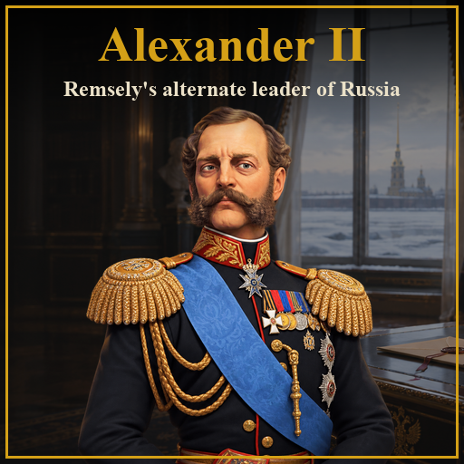

# Remsely's Alexander II

Мод для Civilization VI: **Александр II, Император-Освободитель**, как альтернативный лидер России.



## Что в моде

**Способность «Великие реформы»**
- *Освобождение крестьян:* строители получают +1 заряд, пастбища дают +1 производства, фермы дают +1 производства за каждые 2 соседние фермы (максимум +2 при 4 соседях).
- *Земства:* города с назначенным губернатором получают +2 культуры и +4 лояльности. Начиная со Средневековья с каждой новой эпохой бонус растет на +1 культуры и +2 лояльности (Будущее: +9 и +18).
- *Военная реформа:* улучшение юнитов стоит на 50% меньше золота.

**Повестка ИИ «Освободитель».** Нравятся цивилизации, давно не объявлявшие войн; не нравятся те, что объявили войну недавно.

**Остальное:** 11 новых названий городов России (столица Санкт-Петербург), чёрно-золотые цвета границ, портрет, иконка, фон загрузки и фон дипломатии, 31 реплика дипломатии, страница в Цивилопедии. Языки: русский и английский.

Требуется Rise and Fall; Gathering Storm рекомендуется (эпоха «Будущее»). Платформы: Windows и macOS (BLP собраны для обеих; на macOS мод не проверялся в игре).

## Установка

**Из GitHub Releases:**

1. Скачайте `RemselysAlexanderII-vX.zip` из раздела [Releases](https://github.com/Remsely/civ6-alexander-ii/releases) (рядом лежит `.sha256`).
2. Распакуйте папку `RemselysAlexanderII` в `Документы\My Games\Sid Meier's Civilization VI\Mods\`.
3. В игре: «Дополнительно» → «Моды», включите **Remsely's Alexander II**. Лидер появится среди лидеров России в новой партии.

Цвета и списки городов записываются в сохранение при создании партии, поэтому в старых сохранениях лидер не появится.

## Разработка

Только Windows (SDK Civilization VI). Подробности и правила для Claude Code: [CLAUDE.md](CLAUDE.md).

```powershell
python -m venv .venv
.\.venv\Scripts\python.exe -m pip install -r tools\requirements.txt
.\.venv\Scripts\python.exe tools\validate.py       # проверка мода
.\.venv\Scripts\python.exe tools\install.py        # проверка и установка в папку модов игры
.\.venv\Scripts\python.exe tools\slice_art.py      # арт: нарезка портретов, фонов и иконок из art/source
.\.venv\Scripts\python.exe tools\make_art.py       # арт: DDS, .tex, .xlp, .artdef, .dep (BLP собирает Asset Editor)
.\.venv\Scripts\python.exe tools\make_preview.py   # превью workshop/preview.png
.\.venv\Scripts\python.exe tools\package.py        # dist/release/RemselysAlexanderII-v<версия>.zip для GitHub Releases
```

Документы:
- [ROADMAP.md](ROADMAP.md) — план работ;
- [docs/remselys-alexander-ii.md](docs/remselys-alexander-ii.md) — дизайн мода;
- [docs/art-pipeline.md](docs/art-pipeline.md) — как собирается арт;
- [docs/TESTING.md](docs/TESTING.md) — проверка в игре;
- [docs/RELEASING.md](docs/RELEASING.md) — выпуск релиза;
- [docs/terms.md](docs/terms.md) — русские термины;
- [CHANGELOG.md](CHANGELOG.md) — история версий.

Папка `reference/` (в `.gitignore`) состоит из ссылок на файлы игры и выгрузок баз данных, см. раздел «Окружение» в `CLAUDE.md`.

Исходники картинок созданы нейросетями по промптам из [art/prompts.md](art/prompts.md).
